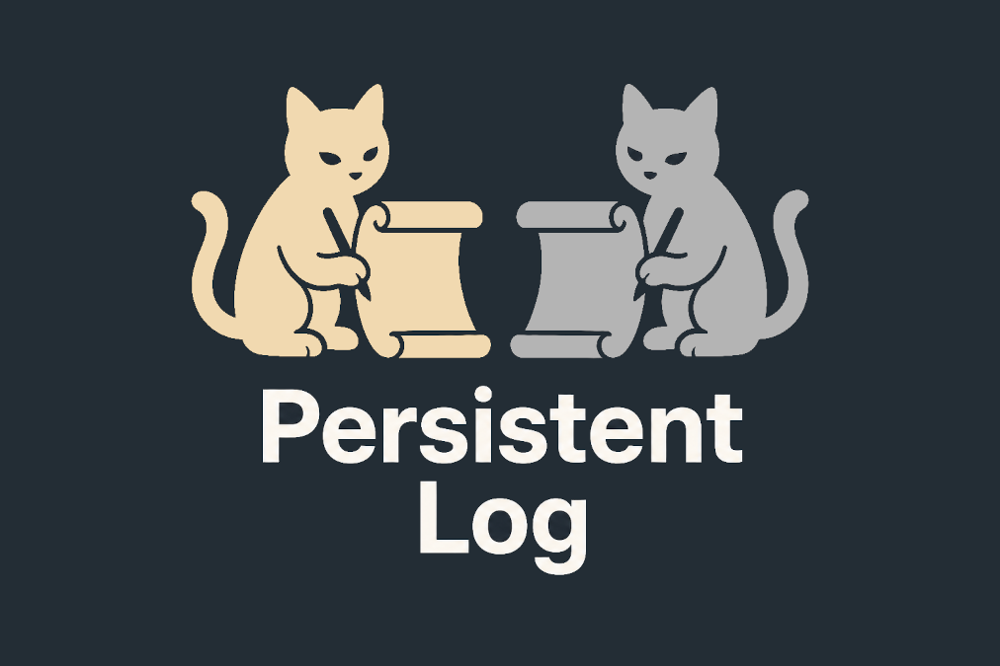
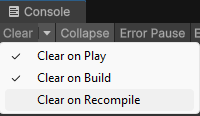
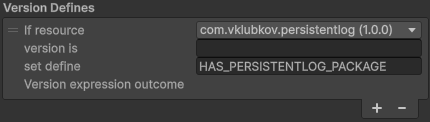
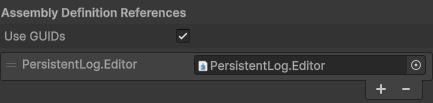
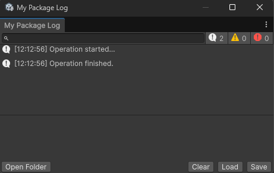

# Persistent Log for Unity

Persistent Log is an optional logging utility for Unity Editor packages, providing robust, persistent logging that survives domain reloads. It is designed to be used programmatically, rather than as a standalone tool with its own entry points.



Persistent Log intercepts Unity console logs and redirects them to a dedicated, interactive Editor window and/or a log file. This window maintains its state and content during assembly reloads, making it ideal for debugging complex Editor processes like package installations or builds.

Unlike the Unity Console, Persistent Log provides a dedicated log window and log file for each package using it.

_Note: if you simply want log messages to persist across domain reloads, you don't need this tool, there's a setting for this in the Unity Console:_




### Key Features

- Log window and data survive domain reloads.


- While active (from the moment it is started until it is explicitly stopped), it Intercepts all logs in the Unity project (not just from the host package), which is necessary to capture the full context of the operation being debugged.


- Does not provide its own menu items or settings. It is intended to be triggered programmatically by other editor tools.


- Designed to be optional. Only 4 API methods, two of which are optional either. No specialized methods for logging needed, use the familiar `UnityEngine.Debug` methods in your package. 


- Does not affect Unity Console logs in any way.


**Interactive UI**:

  - Similar to Unity Console, search by string and toggle visibility for Info, Warning, and Error logs.


  - Double-click a log entry to open its source code; single-click to view the stack trace.


  - Selectable and copyable Stack Trace with clickable file paths for quick navigation.


  - Right-click to copy logs, including a "Copy Compact" option for a simplified format (time and message only). Multiple selections are supported.

  
**File Management**:

  - Automatically writes logs to a file.


  - When started, backups the previous log. Similar to Unity Editor, this is a single backup, but unlike Unity Editor that stores the log for the whole Editor session, this is the log of the previous run only.


  - Load logs from disk or Save the current window content.


  - Open Folder reveals the active log file in your OS file explorer.


## Installation

1. Open the Unity Package Manager.


2. Click the `+` button and choose `Install package from git URL...`


3. Enter the following URL: `https://github.com/vklubkov/UnityPersistentLog.git`.

   Or, if you want to use SSH: `git@github.com:vklubkov/UnityPersistentLog.git`.


## Getting Started

To use Persistent Log in your package, it is recommended to use a Version Define in your `.asmdef` to check for its presence (e.g., `HAS_PERSISTENTLOG_PACKAGE`):



You also need to reference `PersistentLog.Editor` assembly in the same `.asmdef`:



**Important**: **do not** add the Persistent Log package as a dependency in the `package.json`.

Add this to your package's Editor folder:

```csharp
using System;
using PersistentLog;
using UnityEditor;
using UnityEngine;

namespace MyPackage {
    public static class MyPackageTool {
        const string _packageName = "My Package";
        const string _logFilePath = "Logs/MyPackage.log";

        [MenuItem("Tools/My Package/Run Operation")]
        public static void RunOperation() {
#if HAS_PERSISTENTLOG_PACKAGE
            // Start intercepting and open the window
            LogInterceptor.Start(
                _packageName,
                _logFilePath,
                enableAutomatedLogFile: true,
                automaticallyOpenLogWindow: true);
#endif
            try {
                Debug.Log("Operation started...");

                // ... your code ...

                Debug.Log("Operation finished.");
            }
            catch (Exception e) {
                Debug.LogException(e);
            }
            finally {
#if HAS_PERSISTENTLOG_PACKAGE
                // Stop intercepting
                LogInterceptor.Stop(_packageName);
#endif
            }
        }
    }
}
```

After running the operation, this is what the log window should look like:



Log file contents:
```
Timestamp: 2026-05-03 12:12:56.081
Type: Log
Message: |
  Operation started...
StackTrace: |
  UnityEngine.Debug:Log (object)
  MyPackageTool:RunOperation () (at ./Packages/com.vklubkov.testpackage/Editor/MyPackageTool.cs:25)
  


Timestamp: 2026-05-03 12:12:56.153
Type: Log
Message: |
  Operation finished.
StackTrace: |
  UnityEngine.Debug:Log (object)
  MyPackageTool:RunOperation () (at ./Packages/com.vklubkov.testpackage/Editor/MyPackageTool.cs:30)
  
```


## API Reference

- `LogInterceptor.Awake(string packageName)`

  Optional. Starts intercepting logs into an internal buffer. This is useful for capturing early logs before you are ready to open the window or file. This state is automatically cleared on the next domain reload unless `Start` was called. But it is still best to call `LogInterceptor.Stop` explicitly, e.g. in a `catch` or `finally` block.
  

- `LogInterceptor.Start(string packageName, string logFilePath, bool enableAutomatedLogFile, bool automaticallyOpenLogWindow)`

  Enables full logging. It flushes any precached logs from `Awake`, opens the log window (if requested), and begins writing to the specified file (if enabled).


- `LogInterceptor.Stop(string packageName)`

  Stops log interception for the specified package. The log file is no more touched, the log window stays on the screen.


- `LogInterceptor.ShowWindow(string packageName, string logFilePath)`

  Optional. Opens the log window for the specified package without  starting a new logging session. For example, you can use this for creating a menu item in your package menu.


There is a [sample](Samples~/ApiSample/ApiUsage.cs) provided with the package, which you can use as the API usage reference. It also provides the `Tools->Persisntent Log Sample` menu to test how the log window behaves in different circumstances.

## Known Issues and Limitations

- Ensure `LogInterceptor.Stop()` is called to stop interception, otherwise, it might continue capturing logs until the Editor restart.


## AI use disclosure

- The original log window (what now is LogWindow.cs, LogFile.cs, LogSerializer.cs and StackTrace.cs) was created by AI using multiple prompting steps to achieve the required look and functionality, and then was refactored and improved manually.
- AI autocompletion was enabled in the IDE
- The logo image was created by AI.
- This README was create with the help from AI.


## License

[MIT](LICENSE.md)

```
MIT License

Copyright (c) 2026 Vladimir Klubkov

Permission is hereby granted, free of charge, to any person obtaining a copy
of this software and associated documentation files (the "Software"), to deal
in the Software without restriction, including without limitation the rights
to use, copy, modify, merge, publish, distribute, sublicense, and/or sell
copies of the Software, and to permit persons to whom the Software is
furnished to do so, subject to the following conditions:

The above copyright notice and this permission notice shall be included in all
copies or substantial portions of the Software.

THE SOFTWARE IS PROVIDED "AS IS", WITHOUT WARRANTY OF ANY KIND, EXPRESS OR
IMPLIED, INCLUDING BUT NOT LIMITED TO THE WARRANTIES OF MERCHANTABILITY,
FITNESS FOR A PARTICULAR PURPOSE AND NONINFRINGEMENT. IN NO EVENT SHALL THE
AUTHORS OR COPYRIGHT HOLDERS BE LIABLE FOR ANY CLAIM, DAMAGES OR OTHER
LIABILITY, WHETHER IN AN ACTION OF CONTRACT, TORT OR OTHERWISE, ARISING FROM,
OUT OF OR IN CONNECTION WITH THE SOFTWARE OR THE USE OR OTHER DEALINGS IN THE
SOFTWARE.
```